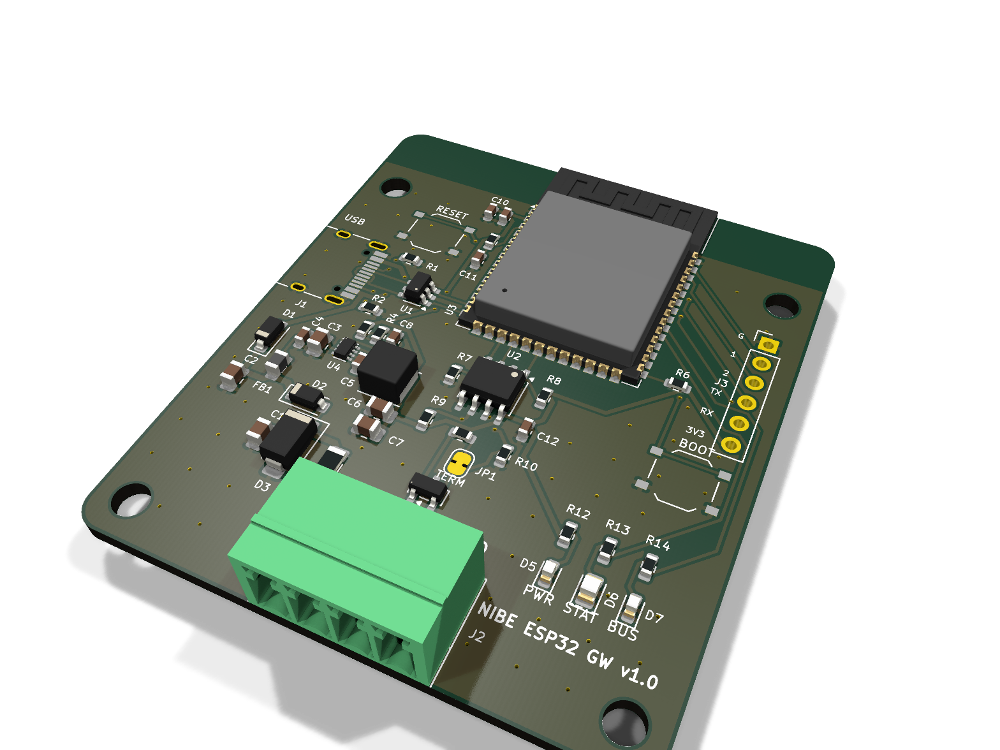
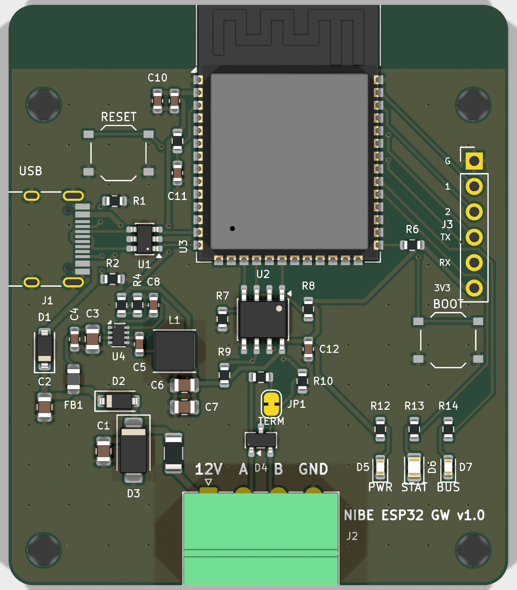
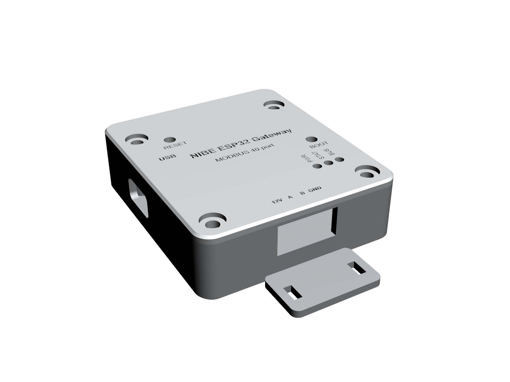
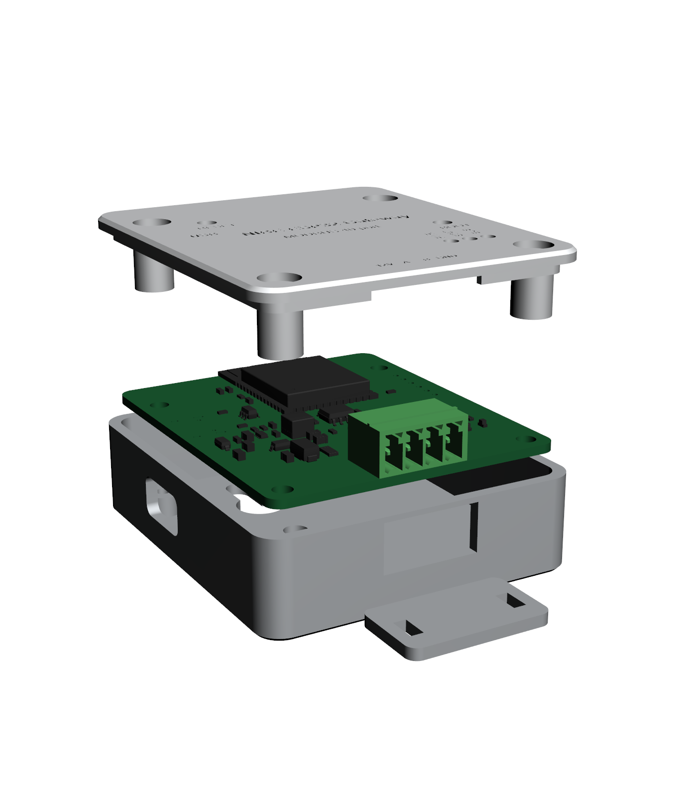

# NIBE ESP32 Gateway

An open-hardware ESP32-S3 board that plugs into the accessory bus of a NIBE
F-series heat pump (the MODBUS 40 port) and gives you local Wi-Fi access to it.
One 4-core cable to the pump carries both the data and the power. Order it fully
assembled from JLCPCB and print the box yourself.

Designed for the NIBE **F750**; the same port exists on F370, F470, F730,
F1145, F1155, F1245, F1255, SMO 40 and several VVM models.



> **Status: rev 1.0, design complete, not yet built.** The schematic and board
> pass KiCad's ERC and DRC, and every part was in stock at JLCPCB on 2026-11-25.
> No board has been made or tested on a heat pump yet. Firmware comes next.

## What it does

- Talks to the heat pump on RS-485 the way a NIBE MODBUS 40 accessory does, so
  it works with the existing open-source gateways:
  [esphome-nibe](https://github.com/elupus/esphome-nibe),
  [NibeGW](https://www.openhab.org/addons/bindings/nibeheatpump/),
  [nibegw-esp](https://github.com/nptr/nibegw-esp) and the Home Assistant
  [Nibe Heat Pump](https://www.home-assistant.io/integrations/nibe_heatpump/)
  integration.
- Runs from the pump's own 12 V supply (AA3-X4:12), like MODBUS 40.
- USB-C for flashing and bench power.
- Protected against surges, reverse polarity and shorts on the pump cable.

| | |
|---|---|
| MCU | ESP32-S3-WROOM-1-N8R2 (Wi-Fi, Bluetooth LE, 8 MB flash, 2 MB PSRAM) |
| Bus | THVD1450 RS-485 transceiver, ±18 kV ESD, fail-safe receiver, PSM712 TVS, 120 Ω terminator on a cuttable jumper |
| Power | 12 V from the pump (9–18 V) or 5 V USB-C, TPS62933 buck to 3.3 V, PTC fuse, TVS |
| Connectors | 4-pin 3.5 mm pluggable terminal (12V, A, B, GND), USB-C |
| Other | RESET and BOOT buttons, PWR/STAT/BUS LEDs, unfitted 6-pin expansion header |
| Board | 50 × 58 mm, 2 layers |
| Box | 55 × 63 × 18 mm, two printed parts, 4 × M3 screws |

<p>



</p>

## Wiring

| Gateway | F750 terminal AA3-X4 |
|---|---|
| 12V | 12 |
| A | 11 |
| B | 10 |
| GND | 9 |

Then tick MODBUS 40 in the service menu (5.2 or 5.2.4). Full steps, with
safety notes, are in [docs/installation.md](docs/installation.md).

## Make one

1. **Board:** upload the files in [`hardware/production/`](hardware/production)
   to JLCPCB with assembly. See [docs/ordering.md](docs/ordering.md).
2. **Box:** print [`enclosure/base.stl`](enclosure/base.stl) and
   [`enclosure/lid.stl`](enclosure/lid.stl) in PETG or PLA, no supports.
3. **Firmware:** start from [`firmware/`](firmware) (pin map and an ESPHome
   configuration).
4. **Install:** [docs/installation.md](docs/installation.md).

## Documents

| | |
|---|---|
| [docs/installation.md](docs/installation.md) | Wiring to the F750, enabling MODBUS 40, troubleshooting |
| [docs/ordering.md](docs/ordering.md) | JLCPCB order, loose parts, printing, assembly |
| [docs/protocol.md](docs/protocol.md) | The NIBE accessory bus: electrical layer, frames, commands, timing, sources |
| [docs/design-notes.md](docs/design-notes.md) | Why each part is there, known gaps |
| [docs/schematic.pdf](docs/schematic.pdf) | Schematic |
| [hardware/README.md](hardware/README.md) | How the board is generated and checked |
| [enclosure/README.md](enclosure/README.md) | The box |
| [firmware/README.md](firmware/README.md) | Pin map, first flash |

## Repository

```
hardware/    board: Python source, generated KiCad project, production files
enclosure/   printable box: CadQuery source, STL and STEP
firmware/    pin map and a starting ESPHome configuration
docs/        installation, ordering, protocol, design notes, images
```

The board is generated from Python and checked by KiCad on every build, so a
change is: edit `hardware/generator/circuit.py`, run `hardware/build.sh`, read the
check results. See [hardware/README.md](hardware/README.md).

## Credits

This board stands on work by the NIBE open-source community: the openHAB
NibeGW gateway, esphome-nibe (elupus), NibePi (anerdins), nibegw-esp (nptr) and
the nibe Python library (yozik04). The protocol notes in
[docs/protocol.md](docs/protocol.md) come from their code and issue threads.

NIBE and MODBUS 40 are trademarks of NIBE AB. This project is not made or
endorsed by NIBE. Connecting third-party hardware to your heat pump is at your
own risk.

## Licence

- Hardware (board, schematic, enclosure): [CERN-OHL-P-2.0](LICENSE-HARDWARE)
- Software and scripts: [MIT](LICENSE-SOFTWARE)

---

### På svenska

Ett öppet ESP32-S3-kort som kopplas till tillbehörsbussen (MODBUS 40-porten) på
NIBE:s F-serie, till exempel F750. En 4-ledarkabel till plint AA3-X4 (12V, A, B,
GND) ger både data och ström. Kortet beställs färdigmonterat från JLCPCB med
filerna i `hardware/production/`, och lådan skrivs ut med 3D-skrivare från
`enclosure/`. Revision 1.0 är färdigritad och kontrollerad i KiCad men ännu inte
tillverkad eller testad på en värmepump. Mjukvaran är nästa steg.
