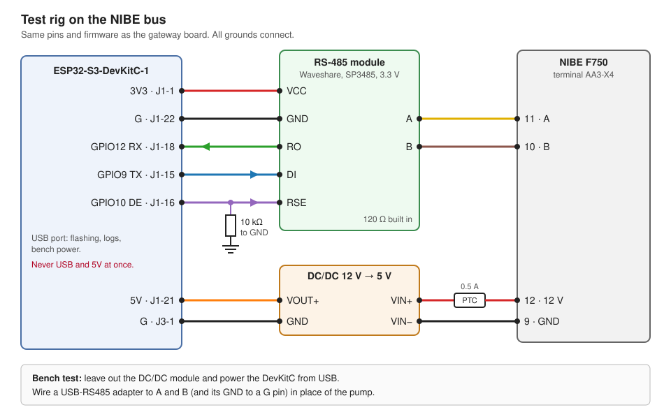

# Test rig: try the firmware and the pump before you order boards

You can test most of the gateway with parts from an electronics shop: an
ESP32-S3 development board, an RS-485 module and a small DC/DC module. The rig runs the
same firmware on the same pins as the board, so it answers the open questions
before you pay for assembled boards:

- Does the firmware answer the pump in time, with no alarm 251?
- How much current can AA3-X4:12 supply?
- Does the pump already terminate the bus?
- Do A and B need to be swapped?

It does not test the board's own parts: the TPS62933 power stage, the THVD1450
transceiver, the protection parts and the layout. Only a real board tests those.



## Parts

Prices are from Electrokit (Sweden) on 2026-11-25, including VAT. Any shop
will do, as long as the parts match.

| Qty | Part | Example | Used for |
|---|---|---|---|
| 1 | ESP32-S3-DevKitC-1 with at least 8 MB flash (N8R8, N16R8 or N8R2) | Electrokit 41023863, 249 SEK (out of stock on 2026-11-25); also Mouser and DigiKey | Both tests |
| 1 | 3.3 V RS-485 module with a driver-enable pin: Waveshare RS485 Board (3.3V), SP3485 | Electrokit 41032604, 49 SEK | Both tests |
| 1 | USB-RS485 adapter | Electrokit 41017524 (FT232RL, USB-B), 65 SEK | Bench test: it plays the pump |
| 1 | Step-down DC/DC module, 12 V in, 5 V out, 0.5 A or more: Waveshare DC5-36-TO-DC3V3-5 | Electrokit 41038036, 79 SEK | Pump test |
| 1 | Female-female jumper wires, 10 pcs | Electrokit 41035553, 22 SEK | Both tests |
| 1 | 10 kΩ resistor | any | Pump test |
| 1 | Resettable PTC fuse, about 0.5 A hold current | any | Pump test, in the 12 V wire |
| 1 | 4-core cable, for example LiYY 4×0.5 mm² | any | Pump test |
| – | Multimeter, USB cables | – | Both tests |

The parts cost about 460 SEK, plus the small items.

Notes on the parts:

- **DevKitC.** Any variant with 8 MB flash or more runs the firmware unchanged.
  On the octal-PSRAM variants (N8R8, N16R8) the memory uses GPIO35–37; the rig
  does not need them.
- **RS-485 module.** The Waveshare board has a fixed 120 Ω terminator across A
  and B, like the gateway with jumper JP1 closed. It has no bias resistors, and
  the SP3485 has no idle-bus fail-safe, so the log can show stray bytes between
  telegrams. The gateway drops anything that is not a valid frame.
- **DC/DC module.** It comes set to 5 V. Check the output with a multimeter
  before you connect it to the DevKitC.

## Wiring

| From | To | Signal |
|---|---|---|
| DevKitC J1-1 (3V3) | RS-485 module VCC | 3.3 V |
| DevKitC J1-22 (G) | RS-485 module GND | Ground |
| DevKitC J1-15 (GPIO9) | RS-485 module DI | UART TX |
| DevKitC J1-18 (GPIO12) | RS-485 module RO | UART RX |
| DevKitC J1-16 (GPIO10) | RS-485 module RSE | Driver enable (DE and /RE), high = transmit |
| 10 kΩ resistor | RS-485 module RSE to GND | Keeps the driver off while the ESP32 starts |
| RS-485 module A | AA3-X4:11 | A |
| RS-485 module B | AA3-X4:10 | B |
| AA3-X4:12 | PTC fuse, then DC/DC VIN+ | 12 V |
| AA3-X4:9 | DC/DC VIN− | Ground, also the bus ground |
| DC/DC VOUT+ | DevKitC J1-21 (5V) | 5 V |
| DC/DC GND | DevKitC J3-1 (G) | Ground |

- The pin numbers are the header numbers in Espressif's
  [DevKitC-1 user guide](https://docs.espressif.com/projects/esp-dev-kits/en/latest/esp32s3/esp32-s3-devkitc-1/user_guide_v1.1.html).
- Solder the 10 kΩ resistor between the RSE and GND pins of the RS-485 module.
  The bench test works without it.
- All grounds connect: X4:9 reaches the RS-485 module through the DC/DC
  module and the DevKitC. Without that ground the module reads garbage.
- **Power the DevKitC from one source only.** Espressif allows USB, the 5V pin
  or the 3V3 pin, never two at once. While the DC/DC module feeds the 5V pin,
  keep USB unplugged and read the logs over Wi-Fi.

## Firmware

Flash [`firmware/nibe-gateway.yaml`](../firmware/nibe-gateway.yaml) as it is.
It already targets `esp32-s3-devkitc-1` and uses GPIO9, GPIO12 and GPIO10. Use
the DevKitC's port marked **USB** (the ESP32-S3's own USB), because the firmware
logs to that port. Then set up Wi-Fi as in
[firmware/README.md](../firmware/README.md#3-set-up-wi-fi).

- On DevKitC v1.1 the RGB LED sits on GPIO38, which the firmware drives as the
  STAT LED. The LED may show odd colours; ignore it.
- The status page at `http://nibe-gateway-xxxxxx.local` shows **Heat pump bus**
  and **Telegrams per minute**. Use those in place of the board's LEDs.
- For a BUS LED, wire an LED and a 1 kΩ resistor from GPIO39 (J3-9) to G.

## 1. Bench test, no pump

1. Leave the DC/DC module out. Power the DevKitC from its USB port.
2. Wire the USB-RS485 adapter to the RS-485 module: A to A, B to B. If the
   adapter has a GND terminal, wire it to a G pin on the DevKitC.
3. Run the tester, which plays the pump:

   ```bash
   uv run tools/pump_simulator.py --port /dev/tty.usbserial-XXXX --duration 60 --gateway-ip <gateway IP>
   ```

4. It must end with `RESULT: PASS`, with no replies over 100 ms. If it fails,
   fix that before you go near the pump.

## 2. Measure at the pump, rig not connected

> **Safety.** The heat pump has mains voltage inside. Switch it off at the
> isolator before you open it. If you are not sure, let an electrician do the
> wiring. See [installation.md](installation.md).

1. Switch the pump off. Wire the 4-core cable to AA3-X4:9–12 as in
   [installation.md](installation.md), and lead it out of the pump. Leave the
   far end loose, with the cores apart.
2. With the pump still off, measure the resistance between the A and B cores
   (X4:11 and X4:10). About 120 Ω means the pump terminates the bus. Several
   kΩ or more means it does not.
3. Switch the pump on and measure between the 12V and GND cores (X4:12 and
   X4:9). This is the no-load voltage.

## 3. Run the rig on the pump's 12 V, MODBUS 40 still off

1. Switch the pump off. Connect the cable to the rig as in the table above.
   Unplug USB from the DevKitC.
2. If you can, put the multimeter in series in the 12 V wire, on a mA range.
3. Switch the pump on. The DevKitC's power LED lights and the rig joins Wi-Fi.
4. Note the current, and the 12 V at the rig end while the rig runs. The rig
   draws about 1.5 times the current the board will, because the DevKitC turns
   5 V into 3.3 V with a linear regulator. If X4:12 holds up the rig, it will
   hold up the board.

**Heat pump bus** stays off for now: the pump only talks to MODBUS 40 once you
tick it.

## 4. Turn on MODBUS 40

1. Tick MODBUS 40 in the service menu (see
   [installation.md](installation.md#5-enable-modbus-40-in-the-pump)).
2. Within seconds **Heat pump bus** turns on, **Telegrams per minute** rises
   above zero and the log shows the telegrams.
3. Let it run for at least 15 minutes with no alarm 251. Then add the Nibe Heat
   Pump integration in Home Assistant
   ([firmware/README.md](../firmware/README.md#4-home-assistant)) and read a few
   values.
4. If alarm 251 comes up: untick MODBUS 40, reset the alarm and read the log.
5. If no telegrams arrive: switch the pump off, swap A and B, and try again.

## 5. Take the rig away

Untick MODBUS 40 **first**, then switch the pump off and disconnect. If you
remove the rig with MODBUS 40 ticked, the pump raises alarm 251.

## Write down

| Measurement | Value |
|---|---|
| Bench test result and slowest reply | |
| A–B resistance at X4, pump off | |
| X4:12 voltage, no load | |
| X4:12 voltage with the rig running | |
| Rig current at 12 V, steady and peak | |
| Minutes on the pump without alarm 251 | |
| A and B swapped? | |

These values answer two of the [known gaps](design-notes.md#known-gaps):
whether the pump terminates the bus, and whether X4:12 can feed the board.
