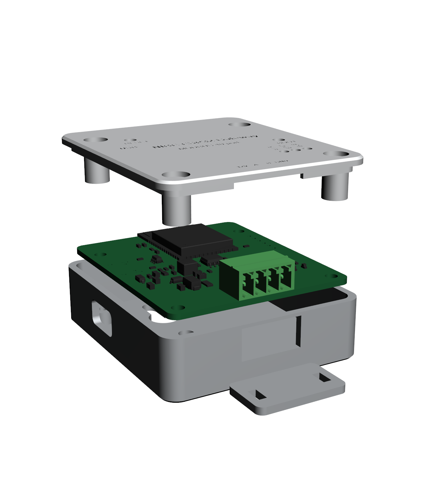

# Enclosure

A two-part box for the board, made in [CadQuery](https://cadquery.readthedocs.io)
from the same dimensions as the board (`hardware/generator/circuit.py`).



| File | |
|---|---|
| `base.stl`, `base.step` | Floor, walls, four board posts, two keyhole slots, cable tongue with zip-tie slots |
| `lid.stl`, `lid.step` | Lid with four clamping posts, LED light holes, pin holes for RESET and BOOT, engraved labels. The STL is turned upside down, ready to print |
| `enclosure.py` | The source |

Outside: 54.8 × 62.8 × 18 mm (77 mm long with the cable tongue).

## Print

PETG or PLA, 0.2 mm layers, 3 perimeters, 25 % infill, no supports. Print the
lid with its top face on the bed (the STL is already turned that way).

## Assemble

1. Hang the base on the wall (two keyhole slots, 22 mm apart) or fix it with
   double-sided tape.
2. Lay the board on the four posts, terminal towards the cable tongue.
3. Fit the lid and drive 4 × M3×16 pan-head screws through lid and board into the
   posts.
4. Zip-tie the heat pump cable to the tongue.

The USB-C opening takes a normal USB-C cable. Header J3 is not fitted; a pin
header there does not fit under the lid.

## Rebuild

```bash
cd enclosure
uv run enclosure.py
```

This writes the STL and STEP files and renders the pictures in `docs/images/`.
It also loads `hardware/production/nibe-esp32-gateway.step` and checks that no
part of the board touches the box; the run fails if anything clashes.
